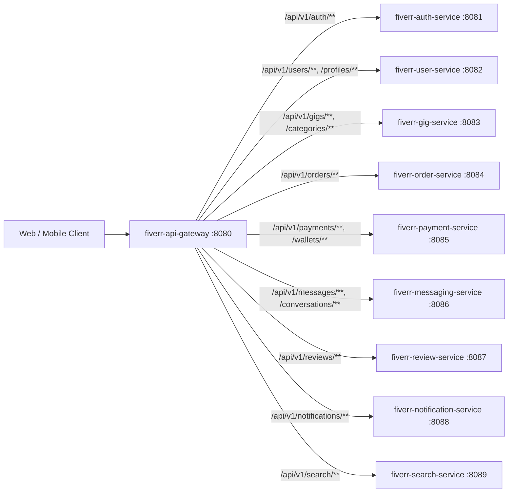

# Fiverr API Gateway (`fiverr-api-gateway`)

Edge API Gateway for the **Fiverr Club** Freelance Marketplace platform, built with **Java 21**, **Spring Boot 3.3.5**, and **Spring Cloud Gateway (2023.0.3)**.

## Architecture Overview



## Key Responsibilities

- **Centralized JWT Verification**: Validates `Authorization: Bearer <token>` signatures and expiration using HMAC-SHA256 (`JwtTokenValidator`) and propagates verified claims (`X-User-Id`, `X-User-Email`, `X-User-Roles`) to downstream microservices.
- **Distributed Tracing Correlation**: Injects and propagates `X-Correlation-Id` across every request and response (`CorrelationIdGlobalFilter`).
- **CORS & Edge Routing**: Non-blocking Netty routing across all 9 domain microservices.
- **Graceful Fallback Endpoints**: `/fallback/{serviceName}` endpoints for circuit-breaker resilience.
- **Kubernetes Readiness & Liveness Probes**: Exposed at `/actuator/health/liveness` and `/actuator/health/readiness` with Prometheus metrics at `/actuator/prometheus`.

## Route Table

| Route ID | Path Predicate | Default Upstream URI | Auth Required |
|----------|----------------|----------------------|---------------|
| `fiverr-auth-service` | `/api/v1/auth/**` | `http://localhost:8081` | Public (`/register`, `/login`, `/refresh`) |
| `fiverr-user-service` | `/api/v1/users/**`, `/api/v1/profiles/**`, `/api/v1/sellers/**` | `http://localhost:8082` | Bearer JWT |
| `fiverr-gig-service` | `/api/v1/gigs/**`, `/api/v1/categories/**` | `http://localhost:8083` | Public (`/api/v1/gigs/public/**`) / Bearer JWT |
| `fiverr-order-service` | `/api/v1/orders/**` | `http://localhost:8084` | Bearer JWT |
| `fiverr-payment-service` | `/api/v1/payments/**`, `/api/v1/wallets/**` | `http://localhost:8085` | Bearer JWT |
| `fiverr-messaging-service` | `/api/v1/messages/**`, `/api/v1/conversations/**` | `http://localhost:8086` | Bearer JWT |
| `fiverr-review-service` | `/api/v1/reviews/**` | `http://localhost:8087` | Bearer JWT |
| `fiverr-notification-service` | `/api/v1/notifications/**` | `http://localhost:8088` | Bearer JWT |
| `fiverr-search-service` | `/api/v1/search/**` | `http://localhost:8089` | Public |

## Build & Run

```bash
JAVA_HOME=/opt/homebrew/opt/openjdk@21 mvn clean test
JAVA_HOME=/opt/homebrew/opt/openjdk@21 mvn spring-boot:run
```
